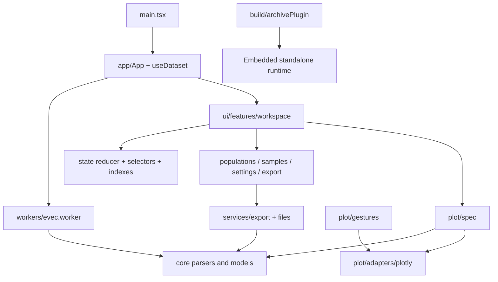

# PCA Views architecture

This document describes the implementation after the October 2026 audit and refactor. The discovery snapshot, risk priorities, and original proposal are in [docs/REFACTOR_PLAN.md](docs/REFACTOR_PLAN.md); the verification history is in [docs/REFACTOR_CHANGELOG.md](docs/REFACTOR_CHANGELOG.md).

PCA Views is a browser application for inspecting precomputed smartPCA coordinates and preparing publication figures. React 19 and TypeScript manage the interface; Vite builds the app and an embedded offline runtime. Plotly supplies SVG and WebGL rendering. There is no backend or database. Uploaded data remains in browser memory until the user explicitly exports a file.

## Ownership and dependencies

| Location                    | Single responsibility                                                 | Dependencies                                        |
| --------------------------- | --------------------------------------------------------------------- | --------------------------------------------------- |
| `src/app/`                  | Dataset lifecycle, file replacement, empty/workspace transition       | Core, worker contracts, services, UI features       |
| `src/core/`                 | Scientific models, parsing, geometry, palettes, cascading styles      | Other core modules; no React or Plotly              |
| `src/state/`                | Persistent session transitions and derived datasets                   | Core                                                |
| `src/plot/spec/`            | Pure figure specification from data and view contracts                | Core, state contracts                               |
| `src/plot/adapters/plotly/` | Vendor loading, mapping, lifecycle, projection, static figure capture | Specification, Plotly                               |
| `src/plot/gestures/`        | Input coordination and viewport math                                  | Pure math and injected plot-box interface           |
| `src/services/files/`       | Browser download transport and object URL release                     | Browser APIs                                        |
| `src/services/export/`      | CSV/evec serialization, PNG composition, offline HTML packaging       | Core and explicit state/specification contracts     |
| `src/workers/`              | Off-main-thread parsing entry                                         | Core parsers                                        |
| `src/ui/primitives/`        | Reusable controls, dialogs, popovers                                  | React, UI hooks and tokens                          |
| `src/ui/features/`          | Task-specific presentation and commands                               | Primitives, core/state contracts, explicit services |
| `src/ui/hooks/`             | Responsive state, keyboard ownership, visible-row memoization         | React, core/state contracts                         |
| `src/ui/styles/`            | Foundations and feature presentation                                  | `src/ui/tokens/`                                    |
| `src/test/`, `e2e/`         | Active module behavior and complete browser workflows                 | Production modules and test tools                   |

The application still has a concrete Plotly canvas component that coordinates the adapter and gestures. A second rendering engine would need its own integration component; the adapter boundary does not imply effortless vendor substitution. Export composition receives a chart image and has no concrete Plotly dependency. `imageFigure.ts` owns Plotly-specific static-figure preparation. Browser download functions remain re-exported from `csvExport.ts` for compatibility.

## Feature organization

- `workspace/`: header, axes/search, navigation toolbar, chart integration, help, and workspace coordination.
- `populations/`: collapsible population panel, rows, and population styling.
- `samples/`: paginated table, inclusion/group edits, and individual sample inspector.
- `settings/`: dialog navigation and separate Chart, Markers, Labels, Legend, Hover, Geometry, and Variance sections.
- `export/`: output choices, resolution, asynchronous preview, and downloads.
- `upload/`: first-run file guidance and a synthetic example preview.

The superseded `src/components/` and `src/domain/` trees were retired after their behavioral fixtures moved to active modules. `legacy/` remains a historical reference and is not imported by the application. Existing `src/ui/components/` barrels forward to feature modules for compatibility; they contain no second implementation.

## Data integrity and session state

A row key identifies a sample independently of its display ID. Repeated IDs therefore remain independent rows. The uploaded dataset stays separate from the effective dataset derived from group edits. A reducer owns axes, search, population styles, sample overrides, exclusions, selection, and chart settings. Component state owns dialog visibility and temporary editing fields.

Style resolution proceeds from sample override to population override to global settings. Visible rows account for search, hidden populations, and explicit exclusions. The table's “Included” state describes explicit inclusion; it does not claim that a hidden or search-filtered row is currently visible. The workspace status separately reports visible, total, selected, and excluded rows.

Coordinate export preserves JavaScript numbers through round-trippable serialization. CSV formula protection and evec group-ID validation remain in the serializers. HTML archives preserve source rows and edited state separately, including axis ranges and dragged label offsets. New files replace archived session state rather than inheriting it.

## Performance and lifecycle

`datasetIndex.ts` keeps weakly owned row lookup and population ordinal maps per immutable dataset. Axis ranges are calculated lazily and cached per component, with copied ranges returned to callers. Dataset replacement and effective-group changes receive their own indexes.

`useVisibleSamples` memoizes filtering using dataset identity, search, exclusion-set identity, and hidden-population names. Inspecting or marking a sample does not allocate another visible-row array. Plot specification still responds to presentation changes; hull/regression geometry is not independently memoized.

The renderer serializes vendor commands and replaces obsolete pending presentation updates. Relayout, resize, flush, and image capture create ordering barriers. Gestures obtain live plot bounds through the adapter; projection and private Plotly layout reads stay inside it. SVG/WebGL bundles remain lazy, with the existing 5,000-sample switch.

PNG capture uses the requested resolution. Composition checks scaled canvas dimensions and total pixel count. Decoded chart images use a weak-key cache; preview URLs are revoked on replacement and unmount. The PNG composer grows space for headings and legends without resizing the captured inner chart.

## Interface and accessibility

The chart is the main working surface. Desktop populations occupy a collapsible margin outside the plot. Mobile populations open on demand as a focus-managed sheet. Frequent tools have names; advanced appearance controls live behind a disclosure. Samples, settings, and export remain persistent header actions.

Modal dialogs render into a body portal, make the workspace inert, trap keyboard focus, and restore the invoking control. Nested palettes and inspectors own Escape according to their visual layer. Population inspectors are non-modal because the plot remains relevant to their task. Toolbar navigation supports arrow keys and Home/End. Reduced-motion styles, focus indicators, responsive layouts, and figure color encodings are separate concerns.

## Validation and remaining boundaries

`npm test`, `npm run build`, and `npm run test:e2e` are local verification commands. Pull requests run all three in CI; GitHub Pages deployment also validates browser behavior before publishing. The build produces an archive runtime that works from `file://` without a CDN.

Known follow-up boundaries: imported archive payloads have only light runtime validation; the main coordinator, sample table, and individual inspector can be split further as features change; independent geometry caching needs measured invalidation rules. Browser checks cover Chromium, including SVG/WebGL and offline files, rather than every browser, screen reader, GPU, or physical mobile device. See the changelog for actual checks and evidence, not an accessibility certification or universal performance claim.
