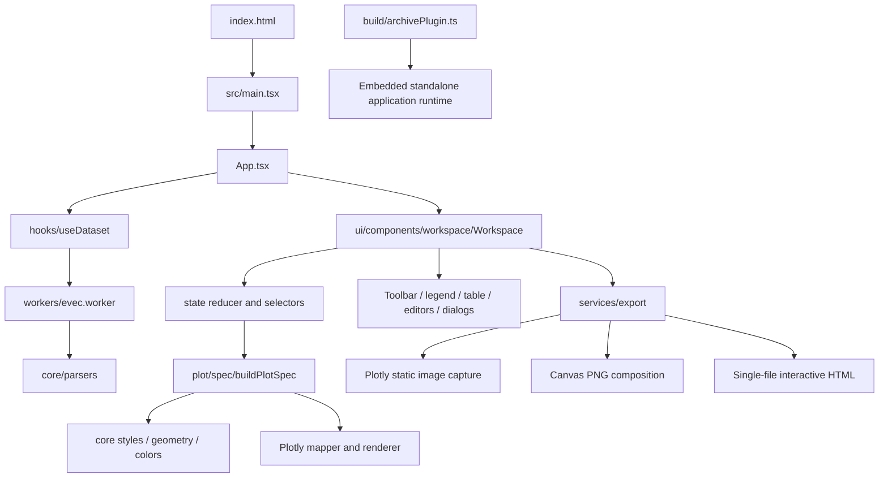

# PCA Views: discovery and incremental refactor plan

Date: 24 October 2026.

Status: discovery was delivered before code changes. The owner subsequently approved automatic execution through all phases and selected plot-first exploration with a collapsible population panel and sample inspection on demand. The sections below retain the pre-change discovery snapshot; implementation results and explicit follow-ups are recorded in [REFACTOR_CHANGELOG.md](REFACTOR_CHANGELOG.md).

## Product requirements

The confirmed audience is genomics researchers preparing analyses and publication figures. Preserve browser-only processing, scientific numeric integrity, duplicate-row identity, source-versus-edited group assignments, existing input/output formats, and offline interactive archives. A substantial UI redesign is in scope. New analysis methods, remote storage, and changes to scientific behavior are not implied by that authorization.

`PRODUCT.md` remains the durable product record. The owner has selected code-first development. The subsequent approved workspace is plot-first; the implementation direction and tokens are documented in DESIGN.md. All three phases of this audit/refactor pass are complete; isolated follow-up opportunities remain explicitly recorded in the changelog.

## 1. Discovery scope

Inventoried all project-owned directories, entry points, sources, configuration, tests, assets, historical code, and metadata. Installed dependencies and generated build/test artifacts were classified separately rather than treated as refactor targets. Source contents and behavioral paths were inspected alongside the earlier audit; this is a fresh check against the current working tree, not a repetition of its test results.

| Directory                           | Inventory                                             | Role                                                                  |
| ----------------------------------- | ----------------------------------------------------- | --------------------------------------------------------------------- |
| `src/`                              | 129 files; 127 TypeScript/TSX files                   | Active implementation plus superseded source and tests                |
| `legacy/`                           | 61 project-owned files                                | Historical viewer, with its own manifest, config, tests, and workflow |
| `build/`                            | 1 file                                                | Offline HTML runtime bundling plugin                                  |
| `e2e/`                              | 4 files                                               | 33 Chromium interaction scenarios                                     |
| `.github/`                          | 1 workflow                                            | Build and GitHub Pages deployment                                     |
| `.impeccable/`                      | Project metadata/configuration                        | Design workflow and hook settings                                     |
| `public/`                           | Favicon                                               | Static public assets                                                  |
| `docs/` and root Markdown           | Product, comparison, architecture, and audit material | Mixed current documentation and historical/proposed design            |
| `dist/`, test outputs, dependencies | Generated or vendor-owned                             | Validate where relevant; do not manually refactor                     |

Raw local `.evec` data was not used for UI discovery. Browser inspection and model measurements used synthetic data.

## 2. Current architecture

Stack: React 19, strict TypeScript, Vite 7, Plotly SVG/WebGL distributions, Lucide icons, Vitest, Playwright, and esbuild for the archive runtime. There is no application backend, database, account system, API data layer, or routing framework.



### Entry points and lifecycle

- `index.html` and `src/main.tsx` mount the browser application.
- `src/App.tsx` coordinates upload/drop, loading/error notices, help, and the empty/workspace transition.
- `src/hooks/useDataset.ts` owns dataset loading and replacement. Hosted operation normally parses through a worker; inline archives use their embedded parsing path.
- `src/workers/evec.worker.ts` reads and parses imported files off the main thread.
- `src/ui/components/workspace/Workspace.tsx` connects persistent state, derived data, the renderer, dialogs, inspectors, export options, and responsive layout.
- `build/archivePlugin.ts` produces an additional bundled runtime so downloaded archives work from `file://` without a server or CDN.

### Business logic, data, and storage

- `src/core/` owns datasets/settings, parsers, geometry, categorical colors, marker symbols, and cascading style resolution.
- `src/state/` owns actions, reducer transitions, session initialization, and derived dataset/filter calculations.
- `src/plot/spec/` constructs a figure specification. `src/plot/adapters/plotly/` translates and renders it.
- `src/services/export/` owns coordinate serialization, image layout/composition, archive serialization, and browser downloads, with some responsibilities currently mixed together.
- Dataset/session data lives in browser memory. Custom color history uses local storage. Interactive archives are explicit file-based persistence.
- There is no database query path; N+1 queries are not applicable. Relevant hot paths are model derivation, rendering, event queues, decoding, composition, and file parsing.

### Dependency findings

The static TypeScript import graph contains no detected circular module dependencies. This includes the current graph's type imports; it does not prove runtime callback coordination is race-free.

The active entry points reach 56 source modules. A reachability result alone is not permission to delete a file: type declarations, test entry points, worker/build entry points, and public exports must be classified separately.

## 3. Pain points

| Priority | Finding                                                 | Evidence / impact                                                                                                                                                                                                                                                |
| -------- | ------------------------------------------------------- | ---------------------------------------------------------------------------------------------------------------------------------------------------------------------------------------------------------------------------------------------------------------- |
| High     | Two independent implementations remain under `src`      | The superseded `src/components` and `src/domain` trees total 6,800 lines and are not used by the active application. Twelve older components match `legacy/`, while six have diverged; the historical copy cannot be substituted blindly.                        |
| High     | Tests can exercise the wrong implementation             | Eight original unit-test files import the superseded domain tree. Some UI tests reproduce local helper logic rather than import or drive the real component.                                                                                                     |
| High     | Oversized coordinator/render functions                  | Active settings is approximately 778 lines, plot 598, inspector 565, workspace 562, sample table 549, and export 468. JSX volume alone is not a defect, but these functions also mix independent state, calculations, effects, and interaction responsibilities. |
| High     | Offline WebGL export remains unreliable in the baseline | The full browser baseline encountered a PNG preview timeout in the offline WebGL archive scenario. Diagnose capture, queue timing, image decode, and test timing before assigning a cause.                                                                       |
| Medium   | Vendor details leak into UI and gestures                | `_fullLayout`, axis offsets/lengths, and projection logic appear outside the Plotly adapter. The PNG composer also imports the concrete mapper.                                                                                                                  |
| Medium   | Unnecessary recomputation                               | `activeSamples` depends on the entire view state. Plot construction rebuilds dataset ordinals and axis bounds on repeated calls. UI-only inspection changes can invalidate downstream work.                                                                      |
| Medium   | Redraw serialization does not eliminate obsolete work   | The renderer queue preserves order but retains every queued update. Wheel/range paths can refresh annotations twice. Viewport commands and replaceable redraw requests need different scheduling semantics.                                                      |
| Medium   | Export memory ownership is unclear                      | An unbounded cache stores decoded images keyed by full data URLs. The export preview's last object URL lacks unmount cleanup.                                                                                                                                    |
| Medium   | Inputs and labels misrepresent state                    | Percent inputs display fractions followed by `%`. Table “Plotted” counts only exclusions, not actual visibility. Varied marker previews omit the sample ordinal used by the plot.                                                                                |
| Medium   | Editing and geometry use inconsistent inputs            | Group edits replace the effective sample list and reset table pagination. Legend hull capability ignores exclusions and does not account consistently for two-point fallback geometry.                                                                           |
| Medium   | Styling is difficult to reason about                    | `styles.css` has 2,708 lines and 144 `!important` declarations, alongside inline layout and partially adopted tokens. Multiple breakpoint systems and repeated rules accumulate.                                                                                 |
| Medium   | Error handling and validation vary by feature           | Thrown parser errors, local messages, silent catches, and lightly checked archive payloads coexist. TypeScript declarations do not validate imported JSON.                                                                                                       |
| Medium   | CI does not cover the behavior users exercise           | The deployment workflow runs unit tests/build on `main` or manually. It has no pull-request browser gate.                                                                                                                                                        |
| Low      | Historical terminology and documentation diverge        | Names vary between population/group, point/sample, and boundary/outline; some old architecture claims describe proposed rather than actual boundaries.                                                                                                           |

### Observed UI/UX

- The desktop workspace has 30 toolbar buttons. Repeated state cyclers depend on icon recognition and memorizing sequences.
- At 390px, the action strip is 847px wide within a 378px container. The document does not overflow, but hidden actions require horizontal discovery.
- The floating population legend covers plotted data and can obscure axis labels on mobile.
- The empty state communicates loading and privacy, but offers limited guidance about the working session's inspection-to-export workflow.
- Existing functionality is substantial; the redesign must improve hierarchy without losing advanced controls.

### Baseline model measurement

A Chromium measurement with 10,000 synthetic samples and 50 populations took approximately 26–48 ms per combined specification/map build across six runs. This excludes Plotly rendering, gesture processing, image export, and file parsing. It motivates removing repeated work; it is not an end-to-end benchmark or a promised speedup.

## 4. Proposed target modules

Use the current framework and preserve useful existing layers. Move a responsibility only when its callers and tests move with it; avoid folder changes that add no boundary or readability benefit.

```text
src/
  app/
    App.tsx                    application composition
    useDataset.ts              dataset loading/session replacement
    useWorkspace.ts            workspace orchestration
  core/
    models/                    datasets and scientific/style contracts
    parsers/                   evec/eval validation
    geometry/                  hull, centroid, regression, range math
    color/                     palettes and color transformations
    style/                     sample → population → global resolution
  state/
    viewActions.ts             typed session intent
    viewReducer.ts             persistent state transitions
    viewState.ts               initialization and state contracts
    datasetIndex.ts            immutable row/population/ordinal indexes
    viewSelectors.ts           derived effective/visible data
  plot/
    spec/                      pure scientific figure specification
    adapters/plotly/           renderer, mapping, projection, events, capture
    gestures/                  input coordination against adapter interfaces
  services/
    files/                     file transport and browser download operations
    export/                    CSV/evec, archive, PNG layout/composition
  workers/                     off-main-thread parsing entry
  ui/
    primitives/                accessible reusable controls and overlays
    hooks/                     keyboard and responsive behavior
    features/
      workspace/               shell, axes, selection actions, status
      populations/             population list and editor
      samples/                 table, filters, row editor, inspector
      settings/                independently maintainable settings sections
      export/                  options, preview, download actions
      upload/                  empty, importing, and invalid-file states
    styles/                    tokens, foundations, feature and responsive CSS
  test/                        tests of active modules
e2e/                           complete user workflows and compatibility
build/                         standalone archive bundling
```

### Allowed dependencies and single responsibilities

| Module                | Responsibility                                                       | Allowed dependencies                                                            |
| --------------------- | -------------------------------------------------------------------- | ------------------------------------------------------------------------------- |
| Core                  | Scientific data and deterministic rules                              | Other core modules; no React, DOM, or Plotly                                    |
| State                 | Session transitions, indexes, and derived data                       | Core; no UI or renderer                                                         |
| Figure specification  | Transform dataset/view contracts into a scientific figure            | Core and state contracts                                                        |
| Plotly adapter        | Concrete rendering, projection, events, viewport, and static capture | Figure specification and Plotly                                                 |
| Gestures              | Translate input into navigation intent                               | Adapter interfaces and pure math                                                |
| File services/workers | Browser I/O and parsing transport                                    | Core and explicit file/message contracts                                        |
| Export services       | Serialize data and compose deliverables                              | Core/state/specification contracts; image capture supplied through an interface |
| UI primitives         | Accessible controls and overlay behavior                             | React, tokens, local UI hooks                                                   |
| UI features           | Present state and emit intent                                        | Primitives and public application/core/state contracts                          |
| Application           | Connect lifecycle, session, features, renderer, and services         | Public interfaces of the above                                                  |

Keep concrete renderer imports out of generic composition code. Preserve archive migrations and existing input/output contracts while internal files move. Retire duplicate trees only after their meaningful tests run against active modules. Keep the external original repository untouched.

## 5. Proposed UI overhaul

Recommended starting structure: plot-first research workspace with a collapsible population panel and sample inspection on demand. The owner is also being offered a linked plot/table workspace and a guided workflow before this becomes a design commitment.

- Make file identity, PC axes, active filters, sample access, and export discoverable without scrolling an icon strip.
- Group navigation and selection tools; retain advanced appearance controls in organized settings rather than equally weighting every cycler.
- Give populations a deliberate panel that does not cover the chart in the normal desktop layout, plus a compact mobile sheet opened on demand.
- Show selection actions only when relevant; distinguish selected, marked, visible, and explicitly excluded samples.
- Keep sample editing near the task, with clear inherited-versus-overridden styles and stable table pagination.
- Separate export scope, format, composition, resolution, and busy/error states. Keep a trustworthy preview and offline-session path.
- Establish a consistent type/spacing/control system, responsive layouts, visible focus, and keyboard ownership for nested overlays.

Use WCAG 2.2 AA as the proposed accessibility implementation target, not a certification claim. Its minimum target-size and focus-obscuring requirements, together with APG toolbar/dialog patterns, provide concrete checks. Aim for comfortable controls beyond the minimum where screen space permits.

References: [WCAG 2.2](https://www.w3.org/TR/WCAG22/), [APG modal dialogs](https://www.w3.org/WAI/ARIA/apg/patterns/dialog-modal/), and [APG toolbars](https://www.w3.org/WAI/ARIA/apg/patterns/toolbar/).

A replacement visual direction must be selected before UI implementation. Product truth and scientific behavior remain fixed through that decision.

## 6. Efficiency work and evidence required

| Change                              | Expected benefit                                                       | Implementation and verification                                                                                  |
| ----------------------------------- | ---------------------------------------------------------------------- | ---------------------------------------------------------------------------------------------------------------- |
| Index immutable datasets            | Avoid repeated key lookup and population ordinal reconstruction        | Per-dataset maps with weak ownership; test duplicate IDs and stable row keys                                     |
| Narrow selector inputs              | Stop inspection/appearance-only changes from reallocating visible rows | Depend on effective dataset, search, exclusions, and visibility; test reference stability and output correctness |
| Cache axis bounds                   | Compute unchanged dataset ranges once per PC                           | Lazy per-PC cache keyed by dataset; verify axis switching and replacement                                        |
| Separate geometry from presentation | Avoid recomputing hulls/regression for unrelated style changes         | Explicit geometry inputs and cache invalidation; verify exclusions, filters, and axis pairs                      |
| Coalesce redraws                    | Prevent obsolete presentation updates from accumulating                | Replace pending redraws while preserving viewport-command order; test rapid zoom and edits                       |
| Release export resources            | Bound retained decoded images and object URLs                          | Weak/bounded ownership plus unmount cleanup; test repeated open/close and failure cleanup                        |
| Capture at requested resolution     | Avoid upscaling a fixed-resolution bitmap                              | Propagate scale and recapture deliberately; verify chart proportions, detail, and canvas bounds                  |
| Preserve lazy vendor loading        | Keep startup from loading both renderer bundles unnecessarily          | Retain SVG/WebGL split; measure first use before considering a distribution change                               |

Do not add a state library, routing framework, component suite, or indexing dependency for these changes. Existing React hooks, maps, weak maps, and typed interfaces are sufficient. Dependency security upgrades should be isolated and justified with their own validation.

## 7. Execution sequence and gates

| Step | Scope                                                                                                                                    | Risk                             | Gate before the next step                                                                      |
| ---- | ---------------------------------------------------------------------------------------------------------------------------------------- | -------------------------------- | ---------------------------------------------------------------------------------------------- |
| 1    | Migrate old behavioral fixtures to active modules; record parity differences; remove superseded implementation only after coverage moves | High impact / low to medium risk | Unit tests, TypeScript/build, relevant browser smoke tests                                     |
| 2    | Correct percentage semantics, stable pagination, sample-aware styles, geometry capability, and export resource ownership                 | High impact / low to medium risk | Regression tests for each changed behavior and build                                           |
| 3    | Add dataset indexes, narrow selectors, and cache immutable derivations                                                                   | High impact / medium risk        | Output/reference tests plus before/after model measurements                                    |
| 4    | Contain renderer projection/capture and refine scheduling                                                                                | High impact / higher risk        | SVG/WebGL zoom, pan, selection, labels, rapid edits, PNG, and offline archives                 |
| 5    | Split feature responsibilities and implement the selected UI direction incrementally                                                     | High impact / higher risk        | Desktop/mobile rendering, keyboard flows, empty/error/busy states, retained advanced workflows |
| 6    | Add browser CI, update architecture/design documentation, and complete independent review                                                | High impact / low to medium risk | Full unit/build/browser checks; design evidence and remaining-limitations record               |

For every executed step, append what moved, why, compatibility implications, verification results, and remaining concerns to a running changelog. Update behavior tests when the approved interaction changes; do not weaken scientific, export, or archive assertions to make a redesign pass.

## 8. Verification record

- Fresh baseline unit suite: **150 passed**, 23 test files.
- Fresh production build: **passed**, including standalone runtime generation. Large Plotly chunk warnings remain informational.
- Fresh browser baseline: **32 passed, 1 failed**. The failure is `viewer.spec.ts`'s offline WebGL archive scenario: the PNG preview did not appear within the 15-second assertion timeout. Other export and archive scenarios passed in this run. Treat the cause as unresolved rather than assuming either a rendering defect or a slow test.
- Desktop and 390px mobile resting states inspected. These are discovery captures, not redesign acceptance evidence.
- Existing working-tree `PRODUCT.md` and `.impeccable/` files were preserved.

## 9. Running changelog

### Discovery and planning

- Inventoried the project and mapped current dependencies and lifecycle.
- Checked the static source graph: no circular module dependencies detected.
- Established current test/build and synthetic model-construction evidence.
- Proposed target ownership, dependency rules, UI structure, risk order, and verification gates.
- Added this planning document. Application code, UI, runtime dependencies, and deployment remain unchanged.

### Implementation

Execution authorized and carried out incrementally. See [REFACTOR_CHANGELOG.md](REFACTOR_CHANGELOG.md) for each step, checks, and remaining limits. The measured baseline above describes the original tree, not the refactored result.
